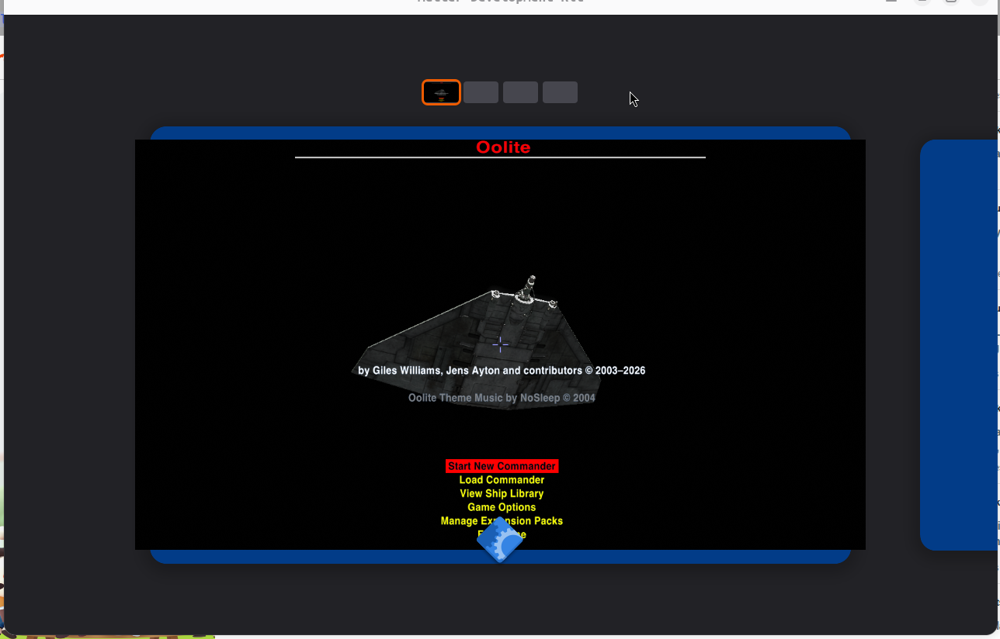

## Reproduced on Ubuntu 26.04 (confirmed by eye)

*The "Mutter Development Kit" window shows GNOME's screen. The Oolite window sits directly on the blue desktop: no title bar, no border.*

**Setup**
- Docker `ubuntu:26.04` with the full **`ubuntu-desktop`** package set (as a user's install would have): gnome-shell **50.1**, `libdecor-0-0` and `libdecor-0-plugin-1-gtk` **0.2.5** installed.
- GNOME run headed: `gnome-shell --wayland --devkit --unsafe-mode`, shown in a Mutter Development Kit window on an X11 host. Run as a normal user, with a fake logind (python-dbusmock) that a container needs.
- Game: upstream **`Oolite-1.93.1-253-deployment-x86_64.AppImage`**, launched with `APPIMAGE_EXTRACT_AND_RUN=1`, `SDL_VIDEODRIVER` not set (as a player would).

**Result**
- The game connects as a **native Wayland** app (SDL3's default; GNOME 50 has no X11 session).
- **No title bar, no border.** Kieron confirmed by eye.
- **libdecor is not loaded** by the game (`/proc/<pid>/maps`), although it is installed. Under GNOME Wayland the app must draw its own title bar, and SDL3 does that through libdecor.
- Game log: "Created a new surface of 1280 x 720, windowed". No errors.
- An earlier run on a minimal image (gnome-shell only, no libdecor installed) gave the same result.

**Cause:** the SDL3 bundled in the AppImage refers to libdecor under a renamed, non-existent file name, so it cannot load libdecor to draw the title bar. See [cause](https://github.com/stickleprojects/oolite/issues/75#issuecomment-6700835714) and [fix and testing](https://github.com/stickleprojects/oolite/issues/75#issuecomment-6703935761).

**Not covered:** Ubuntu 24.04 comparison; the game forced to X11 (`SDL_VIDEODRIVER=x11`).

